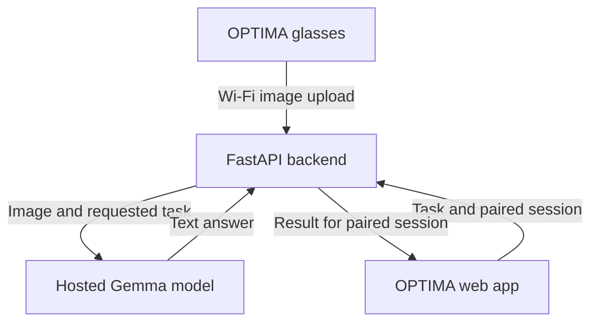

# OPTIMA

**Optical Perception, Translation & Intelligent Multimodal Assistance**

*See beyond limits.*
TEAM MEMBERS: Walid RADI ,MALAK ELAIDI, WALID BOULAZZAFIR,ZAKARIA HARIRA

OPTIMA is an AI-assisted glasses project that turns a deliberately captured image into useful text and spoken feedback. A camera mounted on the glasses captures the scene, a backend sends the image to a hosted Gemma vision-language model, and a compatible web app will present the result on a phone or laptop.

The project focuses on accessible reading and scene understanding for blind and low-vision users. The same tools can help other users translate signs, understand documents, and interpret unfamiliar objects or diagrams.

## What OPTIMA does

| Mode | Purpose | Example |
| --- | --- | --- |
| `read` | Transcribe visible text in its original language. | Read a printed notice. |
| `describe` | Describe a scene and useful visible objects. | Summarize the objects on a desk. |
| `translate` | Translate legible text into a selected language. | Translate a sign into English. |
| `explain` | Explain a visible document, diagram, or object. | Explain a diagram in simple terms. |

A user can also attach a question to the image. Follow-up requests must resend the image: the current API is stateless.

## Current project status

OPTIMA is a prototype with an implemented backend and a proposed wearable-to-web-app integration.

| Component | Current state |
| --- | --- |
| Vision integration | Implemented in `vision.py`, including four task prompts and image validation. |
| HTTP backend | Implemented in `app.py`, with analysis, health, error handling, and static-file serving. |
| Backend validation | Existing validation record reports 22 passing automated tests and an HTTP smoke test; model responses were mocked. |
| Companion web app | Planned. The current `static/` directory is a frontend integration location, not a completed interface. |
| Glasses firmware | Planned for the XIAO ESP32-S3 Sense capture node. |
| Device/session bridge | Planned. Required to deliver glasses-originated results to the paired web app. |
| Hardware | Reference schematics and assembly illustrations prepared; hardware performance has not been measured. |
| Project assets | Research-style design report and a 512 x 512 logo prepared separately. |

## System architecture



The diagram shows the target integrated system. The current `/analyze` route returns an answer only to the client that made the request. A glasses upload does not automatically notify a browser. The session bridge and its result-delivery mechanism still need to be implemented.

1. The user selects a task in the web app and presses the glasses capture button.
2. The glasses capture one still image and upload it to the backend over Wi-Fi.
3. The backend validates the image and sends the image, selected task, language, and optional question to Gemma.
4. The backend associates the answer with the paired device session.
5. The web app receives the result, displays it, and offers speech playback, replay, and stop controls.

Inference runs through a hosted API, rather than on the ESP32. The integrated prototype will therefore require network access.

## Hardware design

The reference glasses model uses a **Seeed Studio XIAO ESP32-S3 Sense** with its camera assembly and antenna.

| Configuration | Main components | Purpose |
| --- | --- | --- |
| Core capture node | XIAO ESP32-S3 Sense, normally open button, green LED, 10 kΩ pull-up, 1 kΩ LED resistor, 100 nF capacitor, USB supply. | Deliberate capture and visible acquisition status. |
| Optional haptics | MCP1700-3302E/TO regulator, AO3400A on a labeled adapter, ERM motor, 1N5819 flyback diode, gate resistors, and decoupling capacitors. | Tactile feedback using a separate regulated motor rail. |
| Optional local audio | MAX98357A breakout, 8 Ω speaker rated at least 2 W, 100 kΩ gain resistor, and 100 µF supply capacitor. | Bench speaker playback; requires an additional TTS-to-PCM path. |
| Optional battery | Protected 1S lithium-ion pack, polarity-verified connector, and insulating enclosure. | A later portable configuration. |

### Proposed GPIO allocation

| Board label | ESP32-S3 GPIO | Assignment |
| --- | --- | --- |
| D0 | GPIO1 | Active-low capture button, with external pull-up and input conditioning. |
| D1 | GPIO2 | Capture-status LED through a series resistor. |
| D3 | GPIO4 | Optional motor-driver gate through a 100 Ω resistor; 100 kΩ gate pull-down. |
| D4 | GPIO5 | Optional I2S audio data output. |
| D5 | GPIO6 | Optional I2S word-select output. |
| D6 | GPIO43 | Optional I2S bit-clock output. |

The audio allocation consumes the usual D4/D5 I2C pins and GPIO43 UART TX function. Camera, PDM microphone, and SD-card pins remain reserved. Match firmware to the purchased board and camera revision.

The core uses USB power for initial testing. The control 3.3 V rail and auxiliary motor 3.3 V rail share ground but remain separate regulator outputs. In battery-only operation, the XIAO 5 V pad is unpowered; the USB-powered optional circuits require a separately specified supply arrangement. The MAX98357A speaker connects between OUT+ and OUT-, with neither speaker terminal connected to ground.

Detailed circuits, component values, power estimates, and the breadboard connection schedule are in the separately supplied design report.

## Companion web app

We will develop a web app compatible with the selected XIAO ESP32-S3 Sense glasses model. Compatibility will be implemented through a shared backend and paired device sessions, with the glasses uploading images over Wi-Fi.

The planned interface will provide:

- Device pairing and connection status.
- Task selection: read, describe, translate, or explain.
- Target-language selection and an optional image question.
- Clear capture, processing, success, and failure states.
- Text answers, speech playback, replay, and stop controls.
- Clear recapture guidance when an image is blurred, cropped, or unreadable.

The app will target phone and laptop browsers. Board-revision compatibility, network reachability, browser behavior, and speech playback must be verified during integration. Browser Bluetooth is not required by the proposed architecture.

Frontend files can be added to `static/`, for example `index.html`, `camera.js`, `speech.js`, and a stylesheet. When `static/index.html` exists, the backend serves it at `/`. Otherwise, `/` redirects to `/docs`.

## AI integration

The backend uses **Gemma 4 through the Gemini API**. Its configured default model ID is:

```text
gemma-4-26b-a4b-it
```

`GEMMA_MODEL` can override this ID. Live model availability and account access must be checked with the API key used for the demonstration.

Gemma performs the project's central interpretation work: transcription, visual description, translation, and explanation. The task prompts request plain text suitable for speech and ask the model to acknowledge unreadable or unsupported content. These instructions do not guarantee factual accuracy; evaluate answers against the source image.

The application uses FastAPI, Starlette, Uvicorn, Pydantic, AnyIO, the Google Gen AI Python SDK, HTTPX, python-dotenv, and Pillow. Exact dependency versions are pinned in `requirements.txt`.

## Backend files

Place this README at the backend package root, alongside the following files:

| Path | Purpose |
| --- | --- |
| `app.py` | FastAPI application, request schema, size limits, concurrency control, and static serving. |
| `vision.py` | Image decoding, task prompts, and Gemma API integration. |
| `requirements.txt` | Pinned runtime dependencies. |
| `.env.example` | Configuration template without an API key. |
| `static/` | Frontend integration directory; interface implementation is pending. |
| `tests/test_app.py` | Automated backend tests with mocked model responses. |
| `TEST_RESULTS.md` | Recorded backend validation and its limits. |
| `LICENSE` | Application-code license. |

## Run the backend

Use Python 3.11 or newer. The existing validation record used Python 3.12.

From the directory containing `app.py` and `requirements.txt`:

```bash
python3 -m venv .venv
source .venv/bin/activate
python -m pip install -r requirements.txt
cp .env.example .env
```

Edit `.env` locally:

```dotenv
GEMINI_API_KEY=your_api_key_here
GEMMA_MODEL=gemma-4-26b-a4b-it
CORS_ORIGINS=
```

Start the development server:

```bash
python -m uvicorn app:app --host 127.0.0.1 --port 8000 --reload
```

- Application entry: <http://localhost:8000>
- Interactive API documentation: <http://localhost:8000/docs>
- Server health: <http://localhost:8000/health>

The localhost address is for development on the computer running the backend. Glasses integration requires a backend address reachable from the device's Wi-Fi network. A browser camera demo should use localhost or HTTPS.

Keep the API key on the server and keep `.env` out of version control. The browser and glasses should not contain the Gemini API key.

### Frontend origin

Serving the web app from `static/` keeps it on the backend's origin. For a separate development server, set its exact origin and restart the backend:

```dotenv
CORS_ORIGINS=http://localhost:5173,http://127.0.0.1:5173
```

## API

### Health

```http
GET /health
```

Response: `{"status":"ok"}`. This checks the HTTP server, not model access or quota.

### Analyze an image

```http
POST /analyze
Content-Type: application/json
```

```json
{
  "image_base64": "<base64 image bytes or an image data URL>",
  "action": "describe",
  "question": "What is on the desk?",
  "language": "English"
}
```

Only `image_base64` is required. The defaults are `describe`, an empty question, and `English`. Unknown request fields are rejected.

Successful response:

```json
{
  "answer": "A short answer grounded in the supplied image."
}
```

To send an existing `photo.jpg` from the command line:

```bash
python - <<'PY' | curl -sS http://127.0.0.1:8000/analyze -H 'Content-Type: application/json' --data-binary @-
import base64
import json
from pathlib import Path

print(json.dumps({
    "image_base64": base64.b64encode(Path("photo.jpg").read_bytes()).decode(),
    "action": "describe",
    "language": "English"
}))
PY
```

The vision module can also be used directly:

```bash
python vision.py photo.jpg --action read --language English
python vision.py photo.jpg --action translate --language French
```

### Limits and behavior

| Item | Current behavior |
| --- | --- |
| Image formats | JPEG, PNG, and WEBP. |
| Decoded image size | At most 8 MiB. |
| Image dimensions | At most 20 megapixels. |
| Request body | At most 12 MiB. |
| Question | At most 2,000 characters. |
| Language | 1-80 characters. |
| Concurrent analyses | Four per server process; additional requests wait. |
| SDK HTTP timeout | 30 seconds; queue time and retries can increase total latency. |
| Storage and history | No application image persistence, database, answer cache, or shared conversation history. |

Errors use a `detail` field. Relevant statuses are 400 for invalid images, 413 for oversized requests, 422 for invalid request fields, 429 for model rate limits, 502 for upstream or unusable model responses, 503 for missing API configuration, 504 for a model timeout, and 500 for an unexpected backend failure.

## Validation

Run the backend tests from the package root:

```bash
python -m unittest discover -s tests -v
```

The recorded suite covers the four actions, image decoding and limits, HTTP validation, upstream error mapping, concurrent requests, static serving, and configured CORS. Model responses are mocked; the suite requires no real API key.

See [TEST_RESULTS.md](TEST_RESULTS.md) for the existing validation record. These checks do not establish live model access, image accuracy, device compatibility, real-world latency, runtime, or user benefit.

For integrated testing, use a printed notice, a translation sign, a desk scene, a simple diagram, and an intentionally unreadable image. Record the board/camera revision, browser, selected task, reference answer, capture-to-speech latency, and failures. Check duplicate results, replay/stop controls, supply stability, and reset behavior.

## Three-hour MVP plan

A four-person build can be divided into these parallel workstreams:

| Workstream | Deliverable |
| --- | --- |
| Hardware and firmware | Camera capture, button/LED behavior, Wi-Fi upload, and a stable USB-powered node. |
| Backend and AI | Verify model access, exercise the four actions, and implement the device/session result bridge. |
| Web application | Task/language controls, pairing state, result display, and accessible processing/error states. |
| Speech and integration | Speech playback/replay/stop, complete-loop testing, documentation, and demo recording. |

| Elapsed time | Milestone |
| --- | --- |
| 0-15 minutes | Agree on the minimal demo, JSON contract, device session, and responsibilities. |
| 15-75 minutes | Work in parallel; first verify image-to-answer using a sample photo. |
| 75-120 minutes | Connect capture, backend result delivery, and web-app speech. |
| 120-150 minutes | Test representative images, recapture behavior, pairing, and duplicate results. |
| 150-180 minutes | Freeze the demo, record a backup, update the README, and prepare submission evidence. |

The initial demo should prove one complete loop: capture an image, obtain a useful answer, and hear it through the web app. Optional motors, local speaker playback, and a worn battery are later extensions.

## Documentation and identity

- **Design paper:** `OPTIMA_Glasses_Research_and_Schematics.pdf`, provided separately, contains the abstract, architecture, reference schematics, assembly illustrations, technical remarks, power calculations, and evaluation plan.
- **Logo:** `OPTIMA_Logo_512.png`, provided separately, is a 512 x 512 PNG with a blue haze inside a rounded-square icon and transparent space outside its corners.

The assembly illustrations are original diagrams in a breadboard CAD style. They are not Tinkercad screenshots or circuit-simulation results. Power and runtime calculations are analytical examples, not measured performance.

## Hackathon submission

Prepared in the Hacktoberfest26 Rabat / Forgebots Club UM6P context. Intended challenge tracks are **Best Open-Source AI Project** and **Best Use of Gemma 4**; eligibility depends on the actual implementation and submitted evidence.

Before submitting:

- Publish an accessible public repository with a clear license file.
- Name the model and key dependencies, and provide working setup instructions.
- Explain how Gemma contributes to the demonstrated functionality.
- Document the meaningful work completed during the event and credit reused components.
- Include a working demo and a short recorded backup.
- Report the actual implementation status and results, including any unfinished integration.
- Follow the event brief's submission instructions and select the applicable challenge tracks.

## Privacy and limitations

Images sent for analysis are transmitted to Google's hosted API. The current backend does not persist images or log request images, questions, or credentials. Device pairing, session authorization, and result delivery remain integration work.

Answers can be incorrect, and the prototype has not been validated for navigation or medical use. Image focus, lighting, framing, network access, and model latency affect usefulness. Hardware reliability, accessibility, and comfort require hands-on evaluation with intended users.

## License and references

Application code is MIT licensed under [LICENSE](LICENSE). Preserve the existing copyright notice. Gemma and all third-party components retain their own licenses and terms; model weights are not included.

- [Gemma through the Gemini API](https://ai.google.dev/gemma/docs/core/gemma_on_gemini_api)
- [Google Gen AI Python SDK](https://github.com/googleapis/python-genai)
- [XIAO ESP32-S3 Sense documentation](https://wiki.seeedstudio.com/xiao_esp32s3_getting_started/)
- [XIAO ESP32-S3 pin multiplexing](https://wiki.seeedstudio.com/xiao_esp32s3_pin_multiplexing/)
- [FastAPI documentation](https://fastapi.tiangolo.com/)
- [OpenGlass hardware precedent](https://github.com/BasedHardware/OpenGlass)
